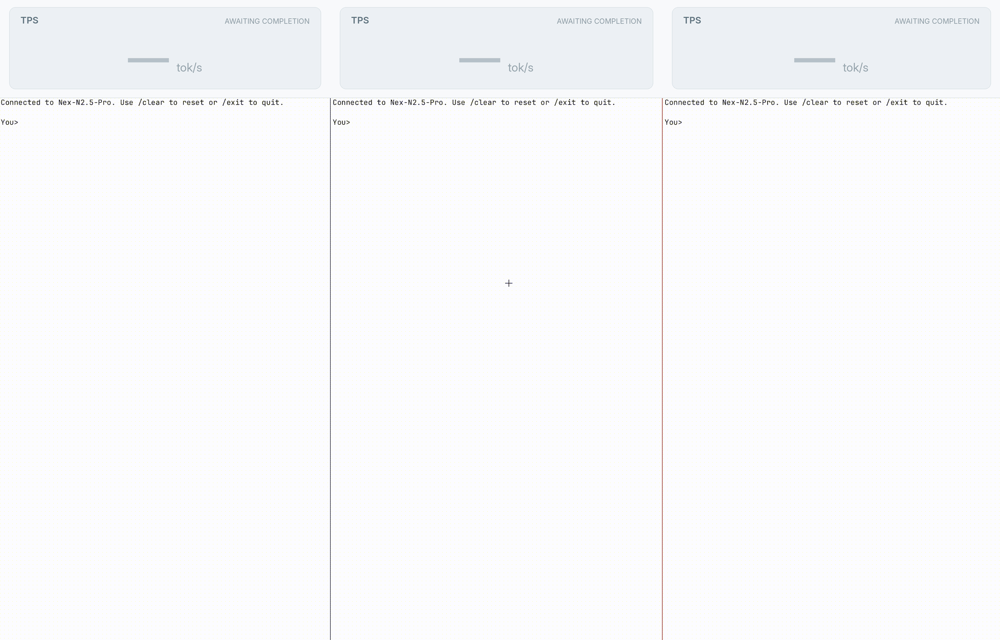
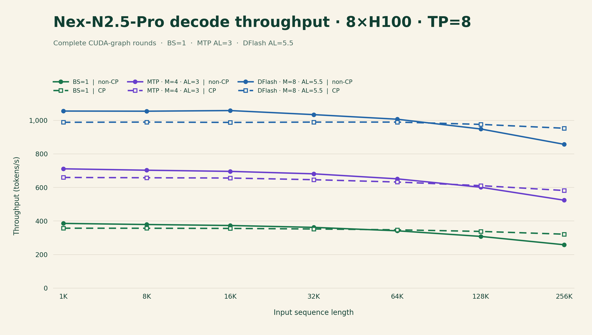

# NexRT

**NexRT** is a low-latency **1-batch decode engine** built with custom CUDA
kernels and CUDA graphs.

NexRT currently supports **Nex-N2.5-Pro** on **8×H100 or H200 (TP=8)**.
Each engine uses one of the following modes:

- **1-batch decoding (BS=1)**
- **MTP decoding (M=4)**
- **DFlash decoding (M=8)**

## Performance

The chart compares 1-batch, MTP, and DFlash decode throughput on 8×H100 (TP=8)
across input lengths from 1K to 256K, with and without context parallelism (CP).
CP helps sustain throughput at long contexts.

Speculative throughput assumes the AL values shown. AL is the average number
of output tokens committed per round.

## Requirements

- **Hardware:** 8×NVIDIA H100 or H200 with TP=8 and NVLS multicast support.
- **Software:** Linux, Bash 4+, CUDA Toolkit 12.9+, Python 3.10+, PyTorch 2.6+,
  and safetensors.
  Prefill requires SGLang, transformers, tokenizers, and numpy. The bridge is
  tested with SGLang 0.5.15, which includes the target feature capture that
  DFlash uses.
- **Weights:** prepared by you; NexRT does not download them.

| Directory | Contents |
| --- | --- |
| `NEXRT_MODEL_DIR` | Nex-N2.5-Pro FP8 checkpoint in Hugging Face layout: `config.json`, sharded safetensors with `model.safetensors.index.json`, tokenizer and chat template. Weights are FP8 with 128×128 block scales (`*.weight_scale_inv`). |
| `NEXRT_MTP_MODEL_DIR` (MTP) | Same layout, with the `mtp.*` tensors of the same model listed in its `model.safetensors.index.json`. This may be the target checkpoint itself. Read only by `tools/extract_layers.py --mtp-src`. |
| `NEXRT_DFLASH_DIR` (DFlash) | DFlash draft for Nex-N2.5-Pro: `config.json` with `dflash_config`, plus one BF16 `model.safetensors`. The draft geometry is fixed and checked at boot (`nex_n2_5_pro/dflash/config.py`). |
| `NEXRT_LAYERS_DIR` | Output of `tools/extract_layers.py`: the CP attention layers and, with `--mtp-src`, `mtp.safetensors` (about 8 GB). |

Ensure the GPU host can find CUDA tools and libraries. Adjust `PATH` for
`nvcc` and `nvidia-smi`, `LD_LIBRARY_PATH` for runtime libraries, and
`LIBRARY_PATH` for linking against `libcuda.so` as needed for your environment.

## Quick start

NexRT currently uses SGLang for prefill.

On the GPU host, set your Python and checkpoint paths:

~~~bash
cd /path/to/NexRT
export NEXRT_PYTHON=/path/to/python
export NEXRT_MODEL_DIR=/path/to/nex_n2_5_pro
export NEXRT_LAYERS_DIR=/path/to/nexrt-auxiliary-weights
~~~

Prepare the auxiliary CP attention weights once:

~~~bash
"$NEXRT_PYTHON" tools/extract_layers.py \
    --src "$NEXRT_MODEL_DIR" \
    --dst "$NEXRT_LAYERS_DIR"
~~~

For MTP, use the following command instead to prepare both CP attention and
MTP weights:

~~~bash
export NEXRT_MTP_MODEL_DIR=/path/to/mtp-checkpoint
"$NEXRT_PYTHON" tools/extract_layers.py \
    --src "$NEXRT_MODEL_DIR" \
    --dst "$NEXRT_LAYERS_DIR" \
    --mtp-src "$NEXRT_MTP_MODEL_DIR"
~~~

Start one mode in the example server, then run one smoke request. The first
boot compiles the kernels and takes several minutes.

~~~bash
NEXRT_SCRIPTS=.claude/skills/run-nexrt/scripts
# 1-batch (default):
"$NEXRT_SCRIPTS/serve.sh" --background --python "$NEXRT_PYTHON"

# Or MTP M=4:
# "$NEXRT_SCRIPTS/serve.sh" --background --python "$NEXRT_PYTHON" -- --mtp

# Or DFlash M=8:
# export NEXRT_DFLASH_DIR=/path/to/dflash-checkpoint
# "$NEXRT_SCRIPTS/serve.sh" --background --python "$NEXRT_PYTHON" -- --dflash

"$NEXRT_SCRIPTS/smoke.sh" --python "$NEXRT_PYTHON"
~~~

`serve.sh` checks the environment before starting and enables verification by
default. The smoke test exercises prefill, handoff, and decode; it reports
`smoke: PASS` when the selected mode's correctness check passes.

To send your own prompt:

~~~bash
"$NEXRT_PYTHON" nex_n2_5_pro/sglang_prefill/bridge_client.py \
    --port 9411 --chat --text "Explain CUDA graphs in one sentence." --max-new 128
~~~

Use `--seed N` to set the sampling seed. See
[DETERMINISM.md](nex_n2_5_pro/DETERMINISM.md) for the repeatability guarantees.

Stop the server when finished:

~~~bash
"$NEXRT_SCRIPTS/serve.sh" --stop --python "$NEXRT_PYTHON"
~~~

## Documentation

- [Running NexRT](.claude/skills/run-nexrt/SKILL.md)
- [Prefill bridge and serving](nex_n2_5_pro/sglang_prefill/BRIDGE.md)
- [DFlash](nex_n2_5_pro/dflash/README.md)
- [Decode determinism](nex_n2_5_pro/DETERMINISM.md)

## Acknowledgement

We thank the teams behind
[TileRT](https://www.tilert.ai/blog/speed-as-the-next-scaling-law-zh.html) and
[SGLang](https://github.com/sgl-project/sglang), and the authors of
[*Every Microsecond Matters*](https://arxiv.org/abs/2607.16100),
for their work and inspiration.

## License

Apache-2.0 — see [LICENSE](LICENSE).
